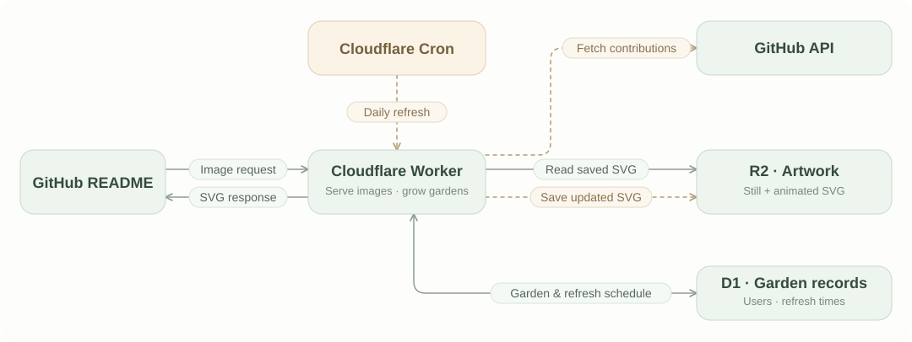

<h1 align="center">GitLeaf</h1>

<p align="center"><em>Your year, in leaves.</em></p>

<p align="center">
  A watercolor portrait of your GitHub contributions.<br />
  One leaf for each day. Your activity adds color.
</p>

<p align="center">
  <a href="https://botanical-garden.ottuck.workers.dev/ottuck?motion=breeze"></a>
</p>

## Add to your README

Paste this line into your GitHub profile README. Replace `ottuck` with your GitHub username.

```html
<p align="center"></p>
```

Refreshes daily. No signup or GitHub Actions setup needed.

Prefer a still portrait? Remove `?motion=breeze`.

## How it works



Solid arrows show image requests and storage access. Dashed arrows show the daily refresh. A garden's first request also fetches GitHub activity and creates its artwork.

| Step | What happens | Powered by |
| :--- | :--- | :--- |
| **01 · Request** | Your README requests the garden at your image URL. | Cloudflare Worker |
| **02 · Grow** | On the first visit, your GitHub contributions become a watercolor SVG. | GitHub API + Worker |
| **03 · Keep** | The artwork is saved; your garden is registered for daily refreshes. | R2 images + D1 schedule |
| **04 · Display** | Later visits reuse the saved SVG, without fetching GitHub again. | Worker + R2 |
| **05 · Refresh** | A daily refresh paints the latest activity into both the still and animated portraits. | Cloudflare Cron |

One leaf represents one day. Its shade follows GitHub's contribution level; larger leaves summarize weekly activity.

Your README keeps the same image URL. Daily refreshes update the artwork on the server, without editing your README or creating Git commits.
