# Botanical README PoC

보태니컬 그림이 **GitHub README에서 표시되고 움직이며, Actions로 갱신되는지** 확인하는 공개 시험 저장소입니다.

**시험 수치: 1,000커밋 / 완전 채색 기준: 3,000커밋**

<table>
  <tr><th>은행나무 · 부분 채색</th><th>양치식물 · 촘촘한 채색</th></tr>
  <tr><td></td><td></td></tr>
</table>

현재 채색 중인 작은 영역이 약 3초마다 은은하게 강조됩니다. 위 두 이미지의 주소는 갱신 후에도 같습니다.

## 검증 범위

- 저장소에 SVG를 업로드하고 README의 상대 경로로 표시합니다.
- 이미지 안에는 JavaScript와 외부 이미지 요청이 없습니다. PNG를 내장한 SVG와 SMIL 애니메이션입니다.
- GitHub Actions의 수동 실행으로 그림을 다시 만들고 README 및 이미지에 반영합니다.
- <code>images/state.json</code>에 입력 수치, 완료 영역, 이미지 해시를 기록합니다.

## 직접 갱신

Actions → **Render botanical README** → **Run workflow**에서 시험 커밋 수와 완성 기준을 입력하세요.

로컬 실행:

```sh
npm ci
npm run render -- 1000 3000
```

## 현재 그림의 한계

이 저장소는 표시·업로드·갱신 검증용입니다. 입력한 수치는 실제 GitHub 기여 통계가 아닙니다. 사용자 활동 집계와 커밋 발생 시 실행 연결은 후속 단계입니다.

기존 PoC의 아래에서 위로 채워지는 자동 마스크를 그대로 사용합니다. 잎별 또는 랜덤 분산 채색은 아직 구현하지 않았습니다. 은행나무 원본의 연필 잎은 완료 상태에도 남습니다. 완성품은 모든 잎의 선화·채색·마스크를 분리한 소재가 필요합니다.
