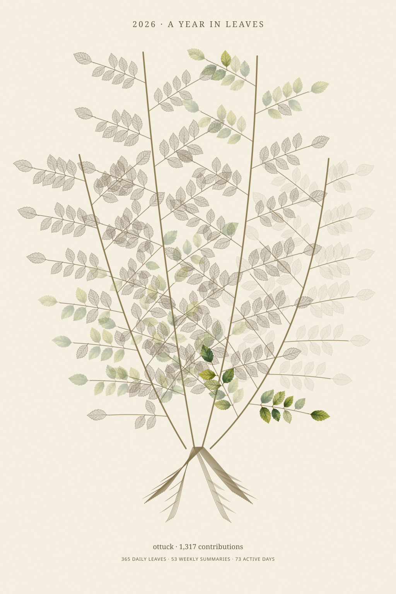

# GitLeaf · A little breeze

같은 GitHub 기록에 작은 바람만 더한 SVG입니다. 가지와 그 가지의 잎이 함께 움직이며 뿌리·종이·글씨는 고정됩니다. 잎의 날짜, 기여 수, 색 단계는 정지 버전과 같습니다.

<table>
  <tr><th>Still · 정지</th><th>Breeze · 은은한 바람</th></tr>
  <tr>
    <td></td>
    <td></td>
  </tr>
</table>

[움직이는 SVG 크게 보기](https://raw.githubusercontent.com/ottuck/gitleaf/main/images/calendar-watercolor-breeze.svg)

8–13초 동안 천천히 움직이는 아주 작은 흔들림입니다. 기기에서 움직임 줄이기를 켜면 정지합니다. 자바스크립트나 외부 이미지 요청을 사용하지 않습니다.

이 페이지의 두 그림은 저장소 Actions가 같은 실제 기여 기록으로 매일 생성합니다. 현재 Worker의 기본 주소는 계속 정지 버전을 제공합니다. 애니메이션을 기본으로 바꾸기 전 비교하는 버전입니다.

로컬 비교: 저장소 루트에서 `python -m http.server 8767 --bind 127.0.0.1` 실행 후 [비교 화면](http://127.0.0.1:8767/motion-preview/)을 엽니다.
